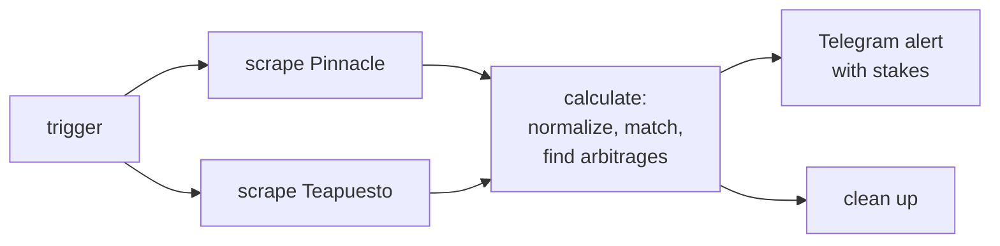

# nba-surebets

A system that finds **sports-betting arbitrage** ("surebets") across sportsbooks in
real time. It scraped NBA odds from several Peruvian sportsbooks every five minutes,
lined up the same bet across books, sized the stakes for each leg, and executed both
legs automatically whenever backing every outcome locked in a profit, with a Telegram
message for each trade.

I ran it with real money in 2023–2024. The typical edge was around **2%** per arbitrage.

## The math

Take two mutually exclusive outcomes, such as *over* and *under* 27.5 points for a
player, priced at decimal odds $o_1$ on one book and $o_2$ on another. The bookmaker's
implied probabilities are $1/o_i$. Each book builds in a margin, so on a single book
they sum to more than 1. Across two books, they sometimes don't:

$$S = \frac{1}{o_1} + \frac{1}{o_2} < 1 \quad\Longrightarrow\quad \text{arbitrage}$$

Staking $B \cdot \frac{1/o_i}{S}$ on each outcome pays $B/S$ whichever outcome wins.
That locks in a return of $\frac{1}{S} - 1$ on the stake $B$. For example, over at 2.08
and under at 2.00 give $S = 0.981$, a **+1.96%** guaranteed return.

See [`surebets/arbitrage.py`](surebets/arbitrage.py). It handles n-way markets, stakes
capped per leg, and rounding to the bookmaker's stake increment (rounding can erase a
thin edge, and the code reports when it does).

## How it works



* **Scrape** ([`surebets/books/`](surebets/books)): one Selenium scraper per book
  (Pinnacle, Teapuesto, Betano, Chúntala), running in parallel as Airflow tasks. Each
  scraper has a time budget, so one slow site doesn't hold up the others.
* **Match** ([`surebets/matching.py`](surebets/matching.py)): each book names the same
  bet differently ("LAL Lakers" vs "Los Angeles Lakers", "Assists" vs "Asistencias
  Más/Menos", "Luka Doncic" vs "Luka Dončić"). Rows are normalized to shared keys
  before joining:
  * over/under markets (game totals, team totals, player props): over on one book
    against under on the other, at the same line
  * handicaps: team X at −4.5 on one book against team Y at +4.5 on the other
  * moneylines: team X on one book against team Y on the other
* **Alert** ([`surebets/alerts.py`](surebets/alerts.py)): the message has the price
  and stake for each leg and the locked-in profit.

### What mattered in practice

* **Speed.** Books correct mispriced lines in under half a minute, so execution was
  automated: the bot re-validated both prices and placed both legs within that window.
  The DAG runs every 5 minutes during betting hours, and each scrape is capped at
  2 minutes. The execution bot (sportsbook logins and bet placement) is not part of
  this repository; this repo covers data collection, matching, the arbitrage math and
  the alerts.
* **Staying small.** Sportsbooks limit or close accounts that keep betting their
  maximum. `SUREBETS_MAX_STAKE` caps every leg, and the stakes are scaled to that cap.
* **Player props.** Most of the arbitrages it found were on player props: points,
  rebounds, assists and combinations such as points + assists.

## Run it

The matching engine runs on sample data without a browser:

```bash
python -m venv .venv && source .venv/bin/activate
pip install -e ".[dev]"
python -m surebets.demo
pytest
```

```
ARB +1.57%  Jayson Tatum · points 27.5
  pinnacle: under @ 1.95 -> stake 50.00
  teapuesto: over @ 2.12 -> stake 45.90
  locked profit +1.41 on 95.90 staked
```

The full pipeline runs with Airflow in Docker:

```bash
cp .env.example .env   # add a Telegram bot token and chat id, and a Fernet key
docker compose up airflow-init && docker compose up -d
# open http://localhost:8080 and unpause the nba_surebets DAG
```

> The scrapers read the live page structure of each site and break whenever a site
> changes its markup. They are kept as a record of how the data was collected, and
> they are not maintained. Check each sportsbook's terms before running them.

## Layout

```
surebets/
  arbitrage.py     odds math: implied probability, return, optimal and capped stakes
  matching.py      normalize names across books and find cross-book arbitrages
  alerts.py        alert message formatting
  pipeline.py      Airflow task callables
  notify.py        Telegram client (prints to stdout without credentials)
  markets.py       market and team names as each book writes them
  books/           one Selenium scraper per sportsbook
dags/              Airflow DAG
examples/          sample odds for the demo and tests
tests/
```

## License

MIT
